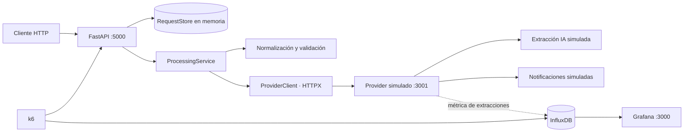

# AI Notification Service

Servicio FastAPI que convierte una instrucción en lenguaje natural en una notificación estructurada. Consulta un provider simulado para extraer los datos, valida la respuesta antes de enviar y permite consultar el estado de cada solicitud.

> Proyecto de prueba técnica. El provider simula la IA y el envío: no se entregan correos ni SMS reales.

**Stack:** Python 3.12 · FastAPI · Pydantic 2 · HTTPX · Docker Compose · k6 · InfluxDB · Grafana

## Contenido

- [Capacidades](#capacidades)
- [Arquitectura](#arquitectura)
- [Requisitos](#requisitos)
- [Ejecución con Docker Compose](#ejecución-con-docker-compose)
- [Desarrollo local](#desarrollo-local)
- [API](#api)
- [Procesamiento y validaciones](#procesamiento-y-validaciones)
- [Configuración](#configuración)
- [Pruebas y calidad](#pruebas-y-calidad)
- [Prueba de carga y métricas](#prueba-de-carga-y-métricas)
- [Integración continua](#integración-continua)
- [Estructura del proyecto](#estructura-del-proyecto)
- [Límites y seguridad](#límites-y-seguridad)
- [Documentación del reto](#documentación-del-reto)

## Capacidades

- API versionada para crear solicitudes, iniciar su procesamiento y consultar su estado.
- Extracción asíncrona mediante un cliente HTTP compartido durante el ciclo de vida de FastAPI.
- Normalización y validación de respuestas de IA con formatos inconsistentes.
- Protección contra envíos duplicados mediante transiciones atómicas de estado.
- Manejo controlado de errores de extracción, provider y notificación.
- Pruebas automatizadas, análisis estático y construcción de imagen en CI.
- Escenario de carga con k6 y panel de métricas en Grafana.

## Arquitectura



El almacén es local al proceso. Las solicitudes recorren los estados `queued → processing → sent|failed`; una llamada repetida para una solicitud ya reclamada no inicia un segundo envío.

## Requisitos

- Docker Engine con Docker Compose v2, para ejecutar el stack completo.
- Python 3.12, si se desea ejecutar la aplicación o las herramientas de calidad fuera de Docker.

## Ejecución con Docker Compose

Desde la raíz del repositorio:

```bash
docker compose up -d provider influxdb grafana
docker compose up -d --build app
docker compose ps
```

URLs locales:

| Servicio | URL |
| --- | --- |
| API y OpenAPI | <http://localhost:5000/docs> |
| Provider simulado | <http://localhost:3001/docs> |
| Grafana | <http://localhost:3000/d/ia-performance-scorecard/> |

Para detener los contenedores:

```bash
docker compose down
```

## Desarrollo local

El provider, InfluxDB y Grafana pueden ejecutarse en Docker mientras FastAPI corre en el entorno Python local:

```bash
docker compose up -d provider influxdb grafana
python -m venv .venv
```

Activa el entorno virtual en la terminal que estés usando:

```powershell
.venv\Scripts\Activate.ps1
```

```bash
source .venv/bin/activate
```

Después instala las dependencias y arranca la API:

```bash
python -m pip install -r requirements-dev.txt
python -m uvicorn app.main:app --reload --host 0.0.0.0 --port 5000
```

La configuración local predeterminada apunta al provider en `http://localhost:3001`. Para cambiarla, define `PROVIDER_BASE_URL` y `PROVIDER_API_KEY` en el entorno antes de iniciar Uvicorn.

## API

La API no requiere autenticación para las llamadas del cliente. La clave se usa internamente al comunicarse con el provider.

### Crear una solicitud

`POST /v1/requests`

```bash
curl -i http://localhost:5000/v1/requests \
  -H "Content-Type: application/json" \
  -d '{"user_input":"Manda un mail a feda@test.com diciendo hola"}'
```

Respuesta `201 Created`:

```json
{"id":"<request-id>"}
```

El cuerpo requiere `user_input` como cadena no vacía. Los campos adicionales o tipos incorrectos producen `422 Unprocessable Entity`.

### Procesar una solicitud

`POST /v1/requests/{request_id}/process`

```bash
curl -i -X POST http://localhost:5000/v1/requests/your-request-id/process
```

La respuesta es `200 OK` cuando el procesamiento termina durante la petición, o `202 Accepted` cuando la solicitud ya está en procesamiento. El cuerpo contiene el ID y su estado. Un ID desconocido produce `404 Not Found`.

### Consultar el estado

`GET /v1/requests/{request_id}`

```bash
curl -i http://localhost:5000/v1/requests/your-request-id
```

Respuesta `200 OK`:

```json
{"id":"<request-id>","status":"sent"}
```

Estados públicos posibles: `queued`, `processing`, `sent` y `failed`.

## Procesamiento y validaciones

1. La solicitud original se envía al endpoint de extracción del provider como mensaje de usuario. El *system prompt* pide un objeto JSON con `to`, `message` y `type`, sin inventar datos faltantes.
2. El pipeline reconoce respuestas negativas, extrae objetos JSON rodeados de texto o Markdown y aplica reparaciones acotadas a formatos conocidos.
3. Los nombres alternativos se normalizan (`recipient`/`destination`, `body`/`text`, `channel`/`method`). Los alias contradictorios, campos obligatorios ausentes y respuestas no recuperables se rechazan.
4. Pydantic valida el destino y el tipo (`email` o `sms`). Si la entrada contiene un único correo o teléfono, el destino extraído debe coincidir.
5. Solo una extracción válida llega a `/v1/notify`. El estado pasa a `sent` después de una confirmación válida del provider; los errores controlados terminan en `failed`.

El cliente HTTP usa timeouts explícitos y límites de conexiones. Los errores del provider, incluidos `401`, `429`, `500` y fallos de red, no se reintentan ciegamente para evitar notificaciones duplicadas cuando el resultado de un envío es incierto.

## Configuración

| Variable | Predeterminado | Descripción |
| --- | --- | --- |
| `PROVIDER_BASE_URL` | `http://localhost:3001` | URL base del provider simulado. |
| `PROVIDER_API_KEY` | `test-dev-2026` | Clave enviada en el encabezado `X-API-Key`. |

Docker Compose define estos valores para el entorno local del reto. La clave predeterminada es una credencial de prueba del mock; no la reutilices como secreto de producción.

## Pruebas y calidad

Instala las dependencias de desarrollo con `python -m pip install -r requirements-dev.txt`. Desde la raíz ejecuta:

```bash
python -m pytest -q
ruff check app tests
ruff format --check app tests
mypy app
```

La suite cubre contratos de API, integración simulada con el provider, parseo y normalización de respuestas, manejo de errores, transiciones de estado e idempotencia bajo concurrencia.

## Prueba de carga y métricas

Con el stack iniciado, ejecuta:

```bash
docker compose run --rm load-test
```

El escenario k6 crea solicitudes, llama a `/process` y consulta su estado mientras aumenta gradualmente hasta 200 usuarios virtuales en aproximadamente 40 segundos. Los resultados se escriben en InfluxDB y se muestran en el [scorecard de Grafana](http://localhost:3000/d/ia-performance-scorecard/).

El mock puede producir rechazos de IA, formatos no recuperables y errores del provider. Por ello, `failed` es un estado de negocio válido y un resultado sin errores HTTP no implica que todas las notificaciones hayan sido entregadas. El reto no define un umbral numérico de latencia o disponibilidad.

## Integración continua

El workflow de GitHub Actions en `.github/workflows/ci.yml` se ejecuta en pull requests dirigidos a `main` y en pushes a `main`. Usa Python 3.12 y valida lint, formato, tipos, pruebas y construcción de la imagen Docker de la aplicación.

Para integrar cambios, crea una rama de trabajo, realiza commits pequeños en inglés que describan cada cambio y abre un pull request a `main`. La integración se completa después de que CI pase y la PR sea revisada.

## Estructura del proyecto

```text
app/
  clients/provider.py   Cliente y contrato de integración con el provider
  main.py               Factoría FastAPI y endpoints
  models.py             Modelos de entrada, salida y dominio
  pipeline.py           Parseo, normalización y validación de extracción
  processing.py         Orquestación de extracción y notificación
  request_store.py      Almacén en memoria y transiciones atómicas
  settings.py           Configuración por entorno
provider/               Mock de IA y notificaciones del reto
platform/
  grafana/              Datasource y dashboard aprovisionados
  influxdb/             Inicialización de la base de métricas
  k6/                   Escenarios de carga y comprobación
tests/                  Pruebas unitarias y de integración
docs/readme.md          Enunciado original de la prueba técnica
.github/workflows/ci.yml
docker-compose.yaml
requirements-dev.txt
```

## Límites y seguridad

- El almacenamiento es en memoria, se pierde al reiniciar y solo protege una instancia; no es una cola durable ni un almacén distribuido.
- El provider es un mock con latencia y respuestas estocásticas. El sistema no envía notificaciones reales.
- El dashboard y la configuración de Grafana están pensados para desarrollo local. No expongas el stack tal como está configurado a una red pública.
- No guardes credenciales reales en el repositorio ni compartas datos personales en logs o capturas.

## Documentación del reto

Consulta el [enunciado original](docs/readme.md) para ver el contrato y las instrucciones de evaluación de la prueba técnica.
